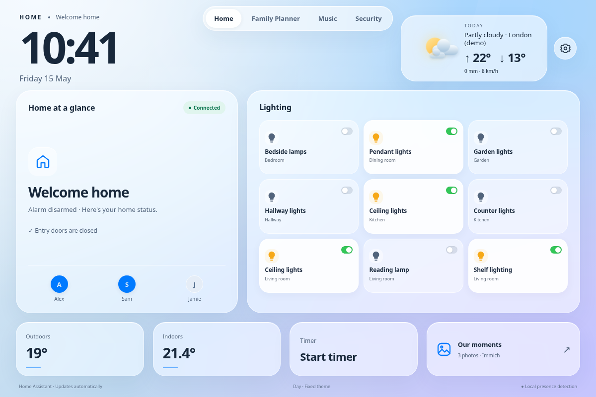
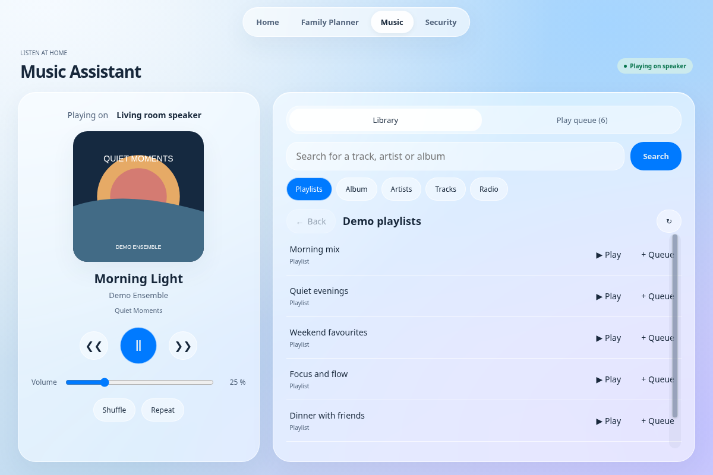
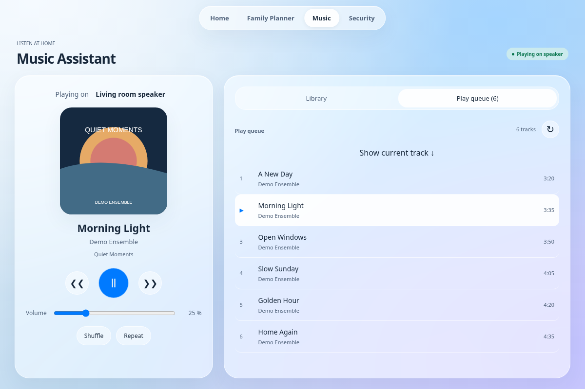
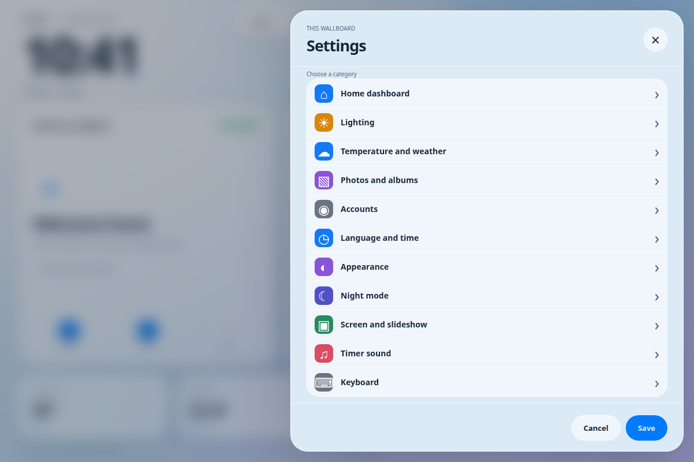
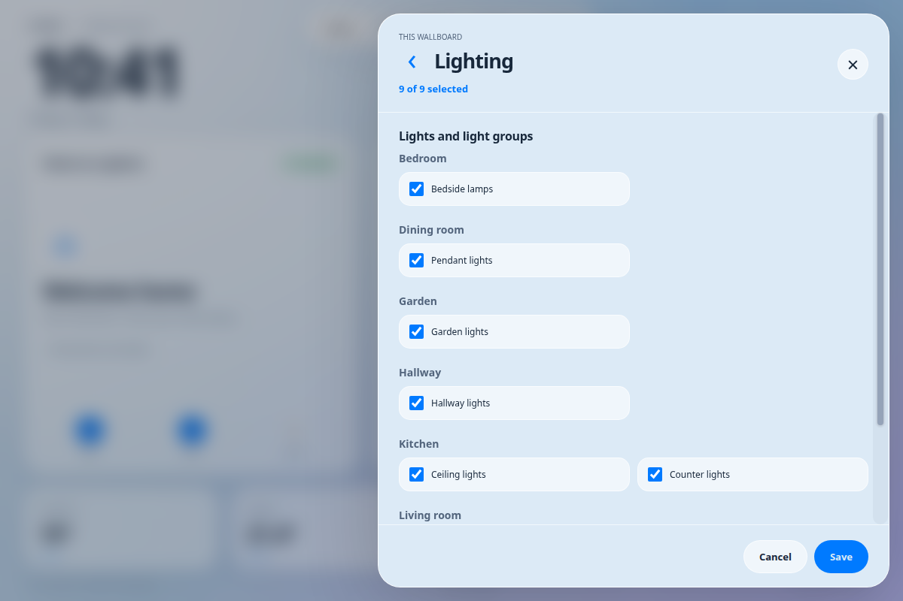
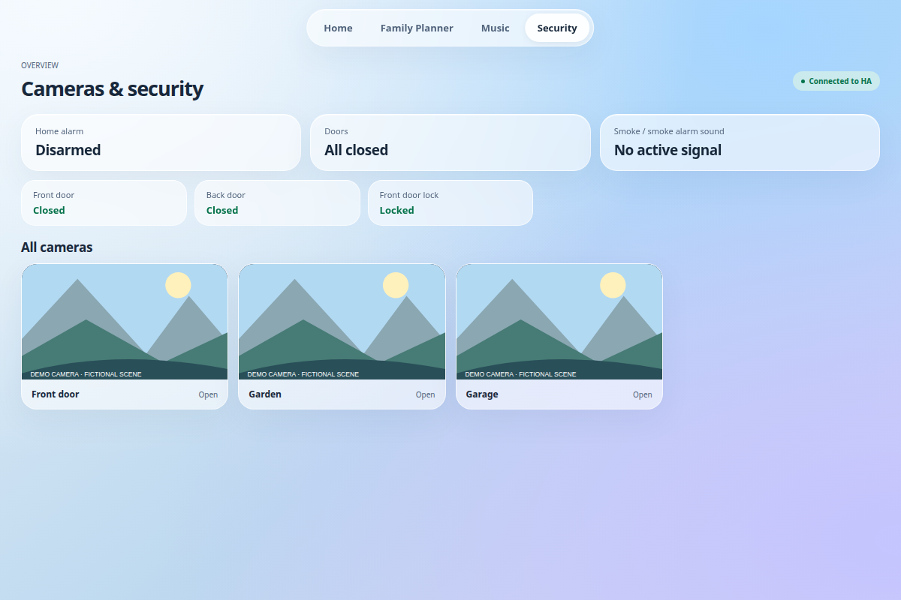
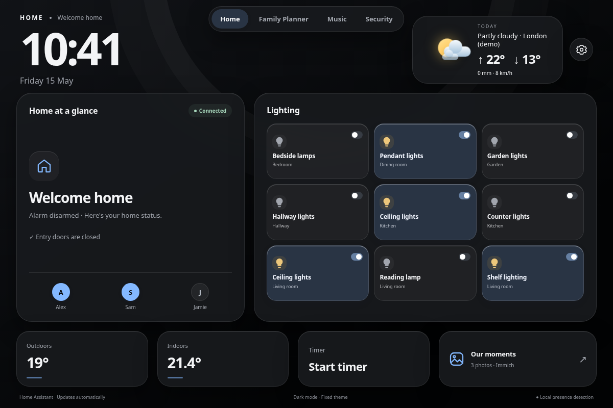
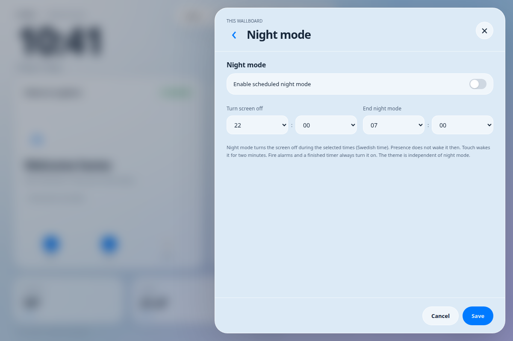
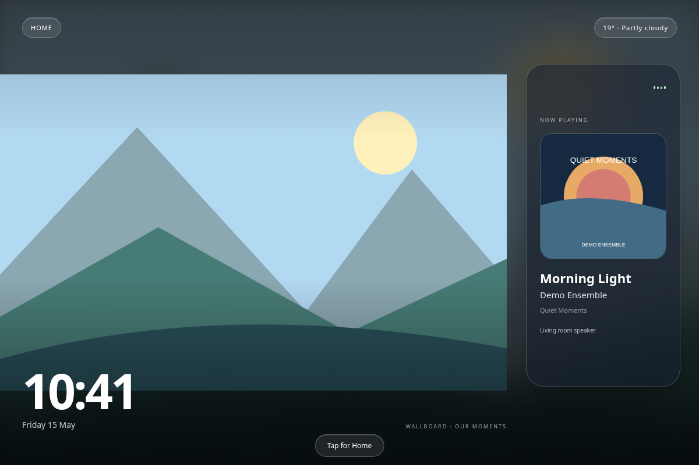

# Home Wallboard

A touch dashboard for Home Assistant on a Linux tablet, with a day/night glass theme, Family Planner, Music Assistant, camera views, a timer and photo slideshows. The interface supports Swedish and English.

## Screenshots

All screenshots use the English interface and entirely fictional demonstration data. Camera views, music artwork and slideshow scenery are original synthetic illustrations. No real household, calendar, account or camera data is included.



| Music library | Music queue |
| --- | --- |
|  |  |

| Settings | Light selection |
| --- | --- |
|  |  |

| Security with fictional camera scenes | Dark mode |
| --- | --- |
|  |  |

| Night schedule | Photo slideshow and now playing |
| --- | --- |
|  |  |

## Try the offline demo

```sh
python3 -m venv .venv
. .venv/bin/activate
pip install -e .
python examples/demo.py
```

Open `http://127.0.0.1:18990`. The read-only demo uses synthetic data and never connects to Home Assistant, cameras, cloud accounts or household devices. It does not import the production server or read its private configuration. Family Planner is a separate application and is not bundled into this demo.

To reproduce the screenshots with an installed Chromium-compatible browser:

```sh
python scripts/capture_screenshots.py --browser /path/to/chromium
```

## Features

- Up to nine HA lights or groups; hold a light to adjust brightness, color and temperature.
- Separate indoor/outdoor temperature sensors, or current outdoor temperature from the same service and location as the daily forecast.
- Home Assistant weather or Open-Meteo with city search and explicit location selection.
- Camera snapshots and a direct stream while HLS connects.
- Today’s Family Planner agenda in the home card: participant colors, three events, event details and a full-day view.
- Music browsing, clickable queue entries and slideshow now-playing information.
- Five original timer sounds, volume and tablet/speaker output selection.
- Immich, local folders, private iCloud albums and private Google Photos selections.
- Scheduled screen-off with start/end times (Europe/Stockholm), temporary touch wake and alarm/timer priority.
- Automatic day/night appearance or fixed Morning/Day/Evening/Night/Dark mode, including the embedded planner.
- Compact Settings categories with back navigation; room-grouped light selection with a fixed counter and room-aware sensor names.
- Swedish/English, explicit 12-/24-hour time controls, optional help text and immediate theme previews.
- Optional local camera presence detection and an on-screen keyboard.
- Configured smoke detector signals take priority over the dashboard; detector mute requires explicit confirmation and supported HA buttons.

## Install

Target: Linux Mint / Ubuntu with Python 3.10+, X11, Chromium, Openbox and systemd. Surface camera support also requires a working libcamera/GStreamer installation. This is not a general-purpose OS installer and does not configure camera drivers, remote SSH, certificates or monitoring.

1. Copy `config.example.json` to a private location and fill in your own HA/Immich credentials and entities. Use dedicated non-admin accounts. Configure camera/detector allowlists explicitly.
2. Run `sudo bash deploy/install.sh /absolute/path/config.json` from this directory.
3. Open `http://127.0.0.1:8090/` on the tablet. The application deliberately accepts only loopback requests. Do not expose it directly to a network or reverse proxy.
4. Optionally configure a kiosk X11 session with the supplied `deploy/kiosk-session.sh`. Enable `wallboard-presence.service` only after verifying the camera pipeline on your hardware.

The installer backs up the previous app/config, creates the dedicated `wallboard` account and installs the app service. It does not enable autologin, remove the existing desktop, change lock-screen settings or disable unrelated services. Device-specific brightness currently targets Intel backlight; adapt `display_loop` for other hardware.

## Private photos

**iCloud:** In Settings → Accounts → iCloud, authorize Photos with your Apple Account and two-factor code, then select a private album under Photos and albums. No public sharing is required. Uses [pyicloud](https://github.com/timlaing/pyicloud), an unofficial client of Apple's web services. Web access to iCloud data must be allowed. Apple may require renewed authentication; Advanced Data Protection or account policies can prevent web access. Password and trusted session files stay in the device's private data directory, never in dashboard preferences or source control.

**Google Photos:** Enable Google Photos Picker API in your Google Cloud project and create an OAuth client of type **Desktop app**. In OAuth consent settings, add your own account as a test user while the app is in testing. Upload the downloaded client JSON in Settings, sign in in the external Google window, then start a named private selection. In Google Photos search for your album, select its photos, finish selection, return to the wallboard and press **Import selected photos**. The selection appears in the album list; select it and save. No public link is created. Images are copied privately to the device. New album additions require a new selection; Picker does not provide unattended album enumeration or continuous album sync. Google Ambient API requires partner access and is not implemented. Testing-mode OAuth refresh tokens may expire after seven days.

The OAuth callback is `http://127.0.0.1:8090/api/photos/google/callback`; complete login in a browser on the device. A cloud account is not preconfigured. Google passwords are entered only on Google's sign-in page. Disconnecting a provider deletes its imported private albums and local cached slideshow copies. Local photos are stored only on the device; disconnect does not delete cloud originals.

**Immich/local/shared albums:** Select an Immich album, upload photos to a local folder, or optionally add an already shared iCloud/Google link. Shared links are optional.

## Weather and temperature

Choose indoor and outdoor HA sensors in Settings → Temperature and weather. Temperature sensors are discovered by HA device class or unit (Celsius, Fahrenheit or Kelvin), and are displayed in Celsius. Unavailable values display a dash. For public weather choose Open-Meteo, search a city, select the matching region/country, and save. Choose “same service and location as forecast” for outdoor temperature to use the selected location's current temperature rather than the daily maximum. Switching cities clears the previous location's weather until new data arrives. Forecasts refresh every 15 minutes; weather older than an hour is marked stale and its current temperature is hidden.

[Open-Meteo](https://open-meteo.com/) weather data: CC BY 4.0; review the service's terms and usage limits for your deployment.

## Development

```sh
python3 -m venv .venv
. .venv/bin/activate
pip install -e . ruff
PYTHONPATH=app python -m unittest discover -s tests -v
ruff check app tests home-assistant examples
ruff format --check app tests home-assistant examples
npx prettier@3.6.2 --check 'app/static/*.js' 'app/static/*.css' 'app/static/*.html'
```

Hardware packages (OpenCV, GI, GStreamer) are installed by the OS. Runtime configuration: `/etc/wallboard/config.json`; private preferences/media/accounts: `/var/lib/wallboard`; app: `/opt/wallboard`. Bind address and callback are intentionally loopback-only. For an SSH tunnel, use `localhost:8090` and finish Google login on the tablet itself.

## Security and scope

Treat the tablet's local user and browser as trusted. Account files are mode 0600 in a 0700 directory. Only predefined provider hosts may receive photo requests; bearer tokens and signed URLs stay server-side. Mutation requests require the local Origin. OAuth uses a short-lived, one-use state and PKCE. Never commit configuration, cookies, refresh tokens, client JSON files, personal photos or runtime backups. See [SECURITY.md](SECURITY.md) and [THIRD_PARTY_NOTICES.md](THIRD_PARTY_NOTICES.md).

Fire status is a supplementary view of HA signals and depends on those integrations. It is not a replacement for certified alarms. Family Planner itself is a separate project; this repository provides its configured HA ingress proxy.


## Night schedule and appearance

In Settings → Night mode, enable the schedule and choose start/end times. Overnight ranges and Swedish daylight-saving changes are supported. Default: disabled, suggested 22:00–07:00. Backlight goes to zero and X11 DPMS is requested; presence alone does not wake the tablet during this interval. A touch wakes it for two minutes and is consumed so it cannot toggle an underlying light. Active fire alarms and a finished timer take priority. When the interval ends, normal presence/idle rules resume.

Settings → Appearance offers Auto or a fixed Morning, Day, Evening, Night or Dark mode. Auto uses Swedish time; Dark mode is neutral nearly black, separate from the existing blue Night palette. The color theme does not enable the screen-off schedule. Settings have a category index and back button, retaining edits until Save/Cancel. Temperature choices include the HA room or, when unassigned, an explicit missing-room label and entity ID.


## Language, time and settings previews

Settings → Language and time offers Swedish or English and 12-hour (AM/PM) or 24-hour time. The clock, slideshow, embedded calendar and night schedule selectors follow the format. Native browser time controls are replaced by explicit hour/minute/AM-PM selectors so the choice works independently of the OS/browser language. Midnight is 12 AM and noon is 12 PM. Internally times stay canonical HH:MM in Europe/Stockholm; switching display format does not move the schedule.

Theme changes apply and save immediately, independently of the rest of the form. Other preview changes are restored by Cancel and persisted by Save. Language, time format and help visibility can also be previewed. Help text is off by default; critical alarm/error information remains visible. Light choices are grouped by HA room and sorted by name, with the selected count fixed in the header.

The wallboard overlays language/time preferences on its embedded Family Planner only. Its ingress proxy preserves the shared calendar's original locale fields on writes, so editing an event through the wallboard does not change the language/time preference used by other HA web clients.

Translations live in `app/static/i18n-catalog.js` (Swedish message IDs → English). Static labels use `data-i18n` spans and explicit localized accessibility attributes; dynamic labels use `WallboardI18n.t`. User data such as people, entity names and event content is not translated. The locale cache contains only language/time settings and is overridden by saved server preferences.


## Shared iCloud account management

Settings → Accounts → iCloud brings calendar and photo access together under one Apple ID. An existing Family Planner calendar connection is read and preserved; its private credentials are not copied to the tablet. Calendar uses its existing CalDAV app-specific password. Private Photos uses the Apple Account password and two-factor verification through pyicloud. A calendar app-specific password cannot replace the Photos login. See [Apple's app-specific password instructions](https://support.apple.com/en-us/102654).

The page shows separate Calendar and Photos status and flags differing Apple IDs. Calendar discovery, selection, reconnect and disconnect use Family Planner's existing private backend via its configured ingress. Reconnecting the same account retains its calendar and enabled state. Disconnecting Calendar affects other Family Planner clients and asks for confirmation; it does not disconnect Photos. Existing calendar login fields are replaced with an Accounts link only in the embedded wallboard view; the standalone HA view remains functional. Photo source/album selection stays in Photos and albums.

No combined password or universal iCloud token is created. Only public account/calendar metadata reaches the browser; upstream CSRF/session credentials and passwords stay in their respective private backends. The account controls apply immediately and do not depend on the dashboard Save button.

## Control the wallboard from Home Assistant

An optional [Home Wallboard custom integration](home-assistant/README.md) provides 46 native entities and protected configuration dialogs. The tablet opens an authenticated outbound connection to HA; no public tablet web service is required. Settings synchronize both ways and can be used in HA dashboards and automations. Account commands are encrypted; passwords never become entity state. See the integration guide for installation, pairing and Google OAuth limitations.

The music page identifies the output speaker, separates Library and Queue, highlights the selected category, and provides explicit Play/Queue actions and collection actions when supported by the provider. Queue tracks are clickable, with a shortcut to the current track. Opening the music page does not start playback.

Scrollable panels have explicit draggable handles for touch, mouse and keyboard. The same support is installed into the embedded Family Planner document, including its dialogs. Regular touch panning remains available.
